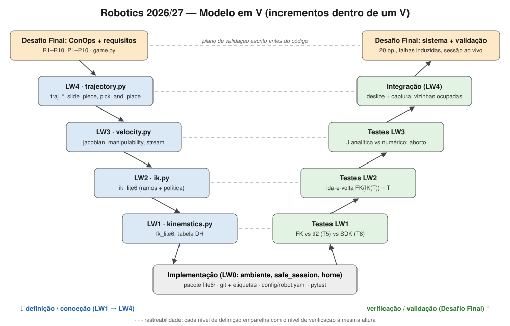

# LW0 — Parte 2: Ambiente e Ciclo de Vida — Grupo NN

<Nome 1> (<nº>) · <Nome 2> (<nº>) · Repositório: https://github.com/jplavos7/robotica-grupoNN

## 1. Ambiente

| Item | Valor |
|---|---|
| Níveis instalados | básico (parte 1), intermédio e avançado |
| Nível intermédio | Windows 11, Python 3.14.7, ambiente virtual `~/venvs/robotica`, VS Code (Python + Pylance), git |
| Simulador de firmware | Docker Desktop (WSL2), `danielwang123321/uf-ubuntu-docker`, perfil Lite 6 (`6 9`), firmware v2.4.0 |
| Via do nível avançado | Via 2, de raiz, em máquina virtual |
| Máquina virtual | VMware Workstation Pro 17, Ubuntu 24.04.5 LTS, 8 GB RAM, 4 núcleos, 60 GB, aceleração 3D ativa |
| ROS 2 / Gazebo | Jazzy Jalisco · Gazebo Sim 8.15.0 (Harmonic) · `xarm_ros2` (ramo `jazzy`): 12 pacotes compilados em 4 min 33 s |
| ROS_DOMAIN_ID | 99 (provisório; a substituir pelo número do grupo, Anexo B) |

**Problemas encontrados na instalação.** (1) O instalador do Ubuntu falhou duas vezes ao descarregar o kernel `linux-image-7.0.0-38-generic` de `pt.archive.ubuntu.com` (`403 Forbidden`, `apt-get ... exit code 100`). Resolvido instalando sem rede e mudando o servidor para `archive.ubuntu.com`. (2) Na VM, a vista 3D do Gazebo ficava cinzenta e a tremer; resolvido com `LIBGL_ALWAYS_SOFTWARE=1` no `~/.bashrc`, como indica a ficha.

### Testes 1–8 (§C.5)

| Teste | Descrição | Resultado | Notas |
|---|---|---|---|
| 1 | talker / listener | Passa | listener recebeu `Hello World: 21…34` em sincronia com o talker |
| 2 | pacotes UFACTORY | Passa | os 8 pedidos presentes, mais `xarm_moveit_servo` e `xarm_sdk` |
| 3 | `lite6_moveit_fake` | Passa | RViz com o Lite 6 e o painel MotionPlanning (grupo `lite6`) |
| 4 | `view_frames` | Passa | `world → link_base → link1 … link6 → link_eef`: 8 referenciais de `link_base` a `link_eef`; primeiro `link_base`, último `link_eef` |
| 5 | `tf2_echo link_base link_eef` | Passa | matrizes abaixo |
| 6 | `gz sim shapes.sdf` | Passa | só depois de `LIBGL_ALWAYS_SOFTWARE=1` (antes: vista 3D cinzenta e a tremer) |
| 7 | `lite6_moveit_gazebo` | Passa | braço estável sob gravidade; Plan & Execute move o braço no RViz e no Gazebo; fator de tempo real ≈ 47 % na VM |
| 8 | SDK vs simulador de firmware | Passa | diferença de 0.20 mm (Pose A) e 0.30 mm (Pose B) |

No Teste 4, as ligações `world → link_base` e `link6 → link_eef` são estáticas (taxa 10000, buffer 0); as seis restantes, uma por junta, são publicadas a ≈19 Hz.

### Teste 5 — matrizes 4×4 (tf2, metros)

**Pose A (home):** juntas = [0, 0, 0, 0, 0, 0] rad = [0, 0, 0, 0, 0, 0]°
```
 1.000  0.000 -0.000  0.087
 0.000 -1.000 -0.000 -0.000
-0.000  0.000 -1.000  0.154
 0.000  0.000  0.000  1.000
```
**Pose B:** juntas = [1.25826, 0.66781, 1.01385, -0.00004, 0.34614, 1.25836] rad = [72.093, 38.263, 58.090, -0.002, 19.832, 72.099]°
```
 1.000 -0.000 -0.000  0.087
-0.000 -1.000 -0.000  0.269
-0.000  0.000 -1.000  0.154
 0.000  0.000  0.000  1.000
```
A Pose B resulta de uma translação de 269 mm em *y* com a orientação mantida (RPY ≈ [180, 0, 0]°). O MoveIt manteve a ferramenta vertical com J6 ≈ J1 e J5 ≈ J3 − J2.

### Teste 7 — Gazebo vs RViz
> No Gazebo, o braço executou o movimento mais lentamente e chegou à pose final com atraso em relação ao RViz, porque a simulação física corria a cerca de 47 % do tempo real na máquina virtual; o RViz mostrou de imediato o movimento planeado, sem qualquer efeito de física.

### Teste 8 — FK do SDK vs tf2

| | Pose A x / y / z (mm) | Pose B x / y / z (mm) |
|---|---|---|
| tf2 (Teste 5) | 87.0 / 0.0 / 154.0 | 87.0 / 269.0 / 154.0 |
| SDK `get_forward_kinematics` | 87.000 / 0.000 / 154.200 | 86.982 / 269.185 / 154.236 |
| diferença tf2 − SDK | 0.000 / 0.000 / −0.200 | 0.018 / −0.185 / −0.236 |
| \|d\| | **0.20 mm** | **0.30 mm** |

As diferenças estão abaixo da resolução com que o `tf2_echo` imprime a translação (3 casas decimais em metros, ou seja, 1 mm). Na Pose B soma-se o arredondamento da conversão dos ângulos de radianos para graus. As duas ferramentas são consistentes dentro da precisão disponível. Unidades: o SDK usa mm e graus; o ROS 2 usa m e rad.

### Reprodutibilidade (§D.4)
Num Windows limpo (ambiente virtual apagado, repositório clonado do GitHub), seguindo apenas o README: o ambiente foi recriado a partir do `requirements.txt`; `pytest` deu 4/5 (falha só o teste do `domain_id`, por definir); `b5_connect.py --move` ligou-se e moveu o braço; o Teste 8 repetiu 0.20 mm. Foram precisas três correções ao README, todas por diferenças entre Linux e Windows: faltavam os comandos para Windows; os comentários `#` na mesma linha partiam os comandos na `cmd`; o `docker run` usava `\` para continuar a linha. No Ubuntu, os Testes 1 e 3 passaram num terminal novo, sem configuração manual.

## 2. Exercício de ciclo de vida

### (a) Requisitos de `safe_session` e `home`

| ID | Tipo | Requisito | Teste |
|---|---|---|---|
| R1 | Funcional | `safe_session` deve ligar-se ao controlador cujo IP está em `config/robot.yaml` e deixar o braço pronto (mode = 0, state ≠ 4, error_code = 0). | T-F1 |
| R2 | Funcional | `safe_session` deve fechar a ligação ao sair, também quando é levantada uma exceção dentro da sessão. | T-F2 |
| R3 | Funcional | `home` deve levar as 6 juntas a `home_joints` com código de retorno 0 e erro máximo ≤ 0.5°. | T-F3 |
| P1 | Desempenho | Tempo de abertura de `safe_session`, pior de 10: limiar < 5 s, alvo < 2 s. | T-P1 |
| P2 | Desempenho | Duração de `home` a partir de `start_joints`, pior de 5: limiar < 15 s, alvo < 8 s. | T-P2 |
| I1 | Interface | Todos os parâmetros devem vir de `config/robot.yaml`; nenhum endereço IP aparece no código Python. No SDK, mm e graus (`is_radian=False`). | T-I1 |
| S1 | Segurança | Se ocorrer uma exceção durante um movimento, `safe_session` deve comandar paragem (state 4) e o braço deve ficar imóvel (< 0.05° em 1 s) sem atingir o alvo; verificado por falha induzida. | T-S1 |
| S2 | Segurança | `home` deve recusar executar, sem movimento, se a velocidade configurada exceder `max_joint_speed`; verificado com configuração induzida. | T-S2 |

### (b) Resultados (simulador de firmware; `logs/lifecycle_sim_20261004_003138.csv`)

| Teste | Resultado | Valor medido |
|---|---|---|
| T-F1 | Passa | ligado, mode = 0, state = 2, error_code = 0 |
| T-F2 | Passa | `connected = False` após exceção |
| T-F3 | Passa | code = 0, erro máximo 0.000° |
| T-P1 | Passa | pior 1.10 s, média 1.08 s (n = 10); alvo cumprido |
| T-P2 | Passa | pior 1.67 s, média 1.67 s (n = 5); alvo cumprido |
| T-I1 | Passa | nenhum IP no código Python |
| T-S1 | Passa | deriva 0.000° em 1 s; parou a 45.1° do alvo |
| T-S2 | Passa | recusou; movimento 0.000° |

**Primeira execução (`logs/lifecycle_sim_20261004_002655.csv`): 3/8.** Cinco testes falharam com `motion_enable -> code=3` (o controlador não respondeu a tempo). Os registos mostraram que todas as falhas aconteciam em ligações abertas 1–2 ms depois de fechar a anterior. Correção: o parâmetro `session.settle_after_disconnect_s = 1.0` em `config/robot.yaml`, aplicado depois de `disconnect()`. Corrigiu-se também o próprio teste T-F2, que confundia a falha de ligação com a falha induzida (passou a usar a exceção `InducedFault`). Repetição: 8/8. Cerca de metade do tempo de P1 é o `set_tcp_offset` (≈0.55 s); o resto é a pausa de 0.5 s antes de declarar o braço pronto.

Os testes no braço real ficam por executar até haver autorização do docente (§D.3b).

### (c) Matriz de rastreabilidade

| Requisito | Módulo / função | Teste | Script | Resultado |
|---|---|---|---|---|
| R1 | `lite6/session.py::safe_session` | T-F1 | `scripts/lifecycle_tests.py` | Passa |
| R2 | `lite6/session.py::safe_session` (finally) | T-F2 | `scripts/lifecycle_tests.py` | Passa |
| R3 | `lite6/session.py::go_home` | T-F3 | `scripts/lifecycle_tests.py` | Passa |
| P1 | `lite6/session.py::safe_session` | T-P1 | `scripts/lifecycle_tests.py` | Passa (1.10 s) |
| P2 | `lite6/session.py::go_home` | T-P2 | `scripts/lifecycle_tests.py` | Passa (1.67 s) |
| I1 | `lite6/config.py::load_config`, `config/robot.yaml` | T-I1 | `tests/test_config.py` | Passa |
| S1 | `lite6/session.py::safe_session` (except → `set_state(4)`) | T-S1 | `scripts/lifecycle_tests.py` | Passa |
| S2 | `lite6/session.py::_check_speed_cap` | T-S2 | `scripts/lifecycle_tests.py` | Passa |

Cobertura: cada requisito tem pelo menos um teste, e cada teste rastreia para pelo menos um requisito.

### (d) Modelo em V

